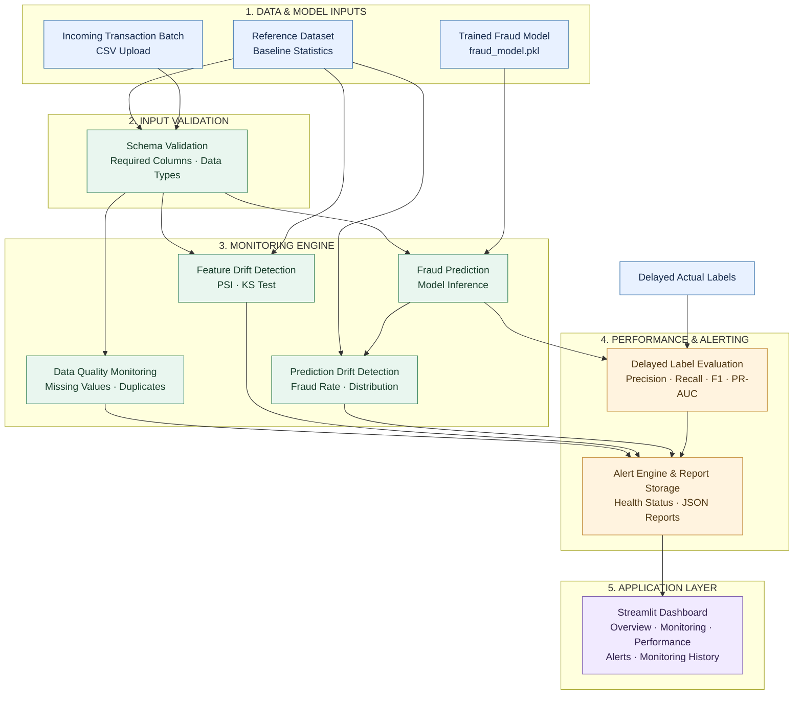

# DriftWatch
### Fraud Model Monitoring & Observability

**An end-to-end machine learning monitoring dashboard for detecting data quality issues, feature drift, prediction drift, and model performance degradation.**

DriftWatch is a Python-based monitoring application built with Streamlit to demonstrate how a trained fraud detection model can be monitored beyond its initial training and evaluation.

The project focuses on the post-training ML lifecycle: monitoring incoming transaction batches, identifying changes in data distributions, tracking prediction behaviour, evaluating delayed labels, and generating model health alerts.

---

## Project Overview

Machine learning models operate in changing environments. The characteristics of incoming data can differ from the data used during model training, potentially affecting prediction behaviour and model reliability.

DriftWatch addresses this monitoring challenge through an interactive dashboard that evaluates incoming transaction batches against a reference dataset and baseline model performance.

Rather than concentrating on model training, this project explores **ML monitoring, observability, statistical drift detection, and delayed feedback evaluation.**

## Architecture

DriftWatch follows a simple monitoring workflow that takes incoming transaction data, performs model monitoring, evaluates performance, and displays the results through an interactive dashboard.

## System Architecture

DriftWatch follows a modular monitoring architecture that connects incoming transaction data, a trained fraud detection model, monitoring components, performance evaluation, and a Streamlit dashboard.

The architecture is divided into five layers, with separate components working together to monitor data quality, feature drift, prediction behaviour, and model performance.

### Architecture Diagram



### Architecture Components

| Component | Description |
|---|---|
| **1. Reference Dataset** | Provides baseline transaction data and statistics for comparison with incoming data. |
| **2. Trained Fraud Model** | The saved machine learning model used to generate fraud predictions. |
| **3. Incoming Transaction Batch** | New transaction data supplied to DriftWatch through CSV upload. |
| **4. Schema Validation** | Checks required columns and the expected input structure before monitoring begins. |
| **5. Data Quality Monitoring** | Identifies data-quality issues such as missing values and duplicate records. |
| **6. Feature Drift Detection** | Compares incoming feature distributions with reference data using PSI and KS tests. |
| **7. Fraud Prediction** | Uses the trained model to predict whether incoming transactions are fraudulent. |
| **8. Prediction Drift Detection** | Monitors changes in prediction distributions and predicted fraud rates. |
| **9. Delayed Label Evaluation** | Compares model predictions with actual transaction labels and calculates precision, recall, F1-score, and PR-AUC. |
| **10. Alert Engine, Reports & Dashboard** | Generates monitoring alerts and health statuses, stores JSON reports, and presents results through the Streamlit dashboard. |

### End-to-End Workflow

1. **Data Input:** DriftWatch receives a new transaction batch along with the reference dataset and saved fraud detection model.
2. **Input Validation:** The incoming batch is checked for the required columns and expected schema.
3. **Data Monitoring:** Data quality checks and feature drift detection are performed by comparing incoming data against the reference dataset.
4. **Prediction Monitoring:** The trained model generates fraud predictions, which are then analysed for changes in prediction behaviour.
5. **Performance Evaluation:** When actual transaction labels become available, DriftWatch evaluates model performance using classification metrics.
6. **Alert Generation:** Monitoring results are processed by the alert engine to determine the overall health status of the batch.
7. **Dashboard & Reports:** Results are saved as monitoring reports and displayed through the Streamlit dashboard.

### Monitoring Lifecycle

DriftWatch supports monitoring both before and after actual transaction labels become available:

- **Before labels arrive:** Data quality, feature drift, and prediction behaviour can be monitored. Model performance is marked as pending.
- **After labels arrive:** Predictions are compared with actual labels to calculate performance metrics and identify potential model performance degradation.

This approach allows DriftWatch to monitor a fraud detection model continuously, even when ground-truth labels are delayed.
## Technology Stack

| Category | Technologies |
|---|---|
| Programming Language | Python |
| Data Processing | Pandas, NumPy |
| Machine Learning | Scikit-learn |
| Statistical Analysis | SciPy |
| Dashboard | Streamlit |
| Visualization | Plotly, Matplotlib, Seaborn |
| Model Persistence | Joblib |
| Version Control | Git, GitHub |

## Model Information

DriftWatch uses a Random Forest classifier trained on a credit card fraud detection dataset.

**Model configuration**

- Algorithm: Random Forest Classifier
- Number of estimators: 100
- Random state: 42
- Class weighting: Balanced
- Parallel processing: Enabled

### Baseline Model Performance

The following metrics were obtained during the initial test evaluation.

| Evaluation Metric | Baseline Score |
|---|---:|
| Precision | 91.53% |
| Recall | 76.06% |
| F1-score | 83.08% |
| PR-AUC | 79.67% |
| ROC-AUC | 95.43% |

The original dataset contains a highly imbalanced target distribution, with approximately 0.17% fraudulent transactions.

These baseline metrics are used as a reference when evaluating subsequent transaction batches.

## Experimental Drift Scenarios

To validate the monitoring pipeline, controlled transaction batches were generated from the reference dataset.

| Batch Type | Configuration |
|---|---|
| Normal Batches | Sampled from reference data |
| Drifted Batch 1 | Amount multiplied by 2.5 |
| Drifted Batch 2 | Amount multiplied by 4 |

Each generated batch contains:

- 1,000 transactions
- 995 legitimate transactions
- 5 fraudulent transactions

The controlled fraud proportion of 0.5% is used for demonstration and differs from the original dataset prevalence.

### Key Experimental Observation

In the `drift_demo_1` experiment:

- DriftWatch detected distribution drift in the `Amount` feature.
- The prediction probability distribution test did not detect statistically significant prediction drift.
- The current predicted fraud rate was higher than the reference fraud rate.

This demonstrates an important monitoring concept:

**Feature drift does not necessarily imply prediction drift.**

A change in incoming feature distributions does not automatically mean that the model's prediction distribution or predictive performance has degraded.

## Delayed-Label Performance Evaluation

In practical fraud detection scenarios, actual transaction outcomes may not be available when predictions are generated.

DriftWatch simulates this situation by accepting a separate labels CSV after the initial monitoring process.

**Expected labels file format**

| transaction_id | actual_class |
|---|---:|
| transaction_001 | 0 |
| transaction_002 | 1 |
| transaction_003 | 0 |

The application matches actual outcomes with saved predictions using `transaction_id`.

It then calculates:

- Precision
- Recall
- F1-score
- PR-AUC

### Example: Drifted Batch 1 Performance

| Metric | Baseline | Current Batch |
|---|---:|---:|
| Precision | 91.53% | 100.00% |
| Recall | 76.06% | 80.00% |
| F1-score | 83.08% | 88.89% |
| PR-AUC | 79.67% | 100.00% |

**Interpretation:** The monitored batch showed improved metrics compared with the baseline in this experiment, despite the detected feature drift.

However, the batch contained only five fraudulent transactions. Therefore, these results are illustrative and should not be interpreted as evidence of general model improvement.

## Project Structure

```text
DriftWatch/
│
├── data/
│   ├── batches/
│   └── incoming_samples/
│
├── models/
│   └── fraud_model.pkl
│
├── reports/
│
├── src/
│   ├── inspect_data.py
│   ├── prepare_data.py
│   ├── train_model.py
│   ├── save_baseline.py
│   ├── generate_batches.py
│   ├── data_quality.py
│   ├── test_data_quality.py
│   ├── drift_detection.py
│   ├── test_drift_detection.py
│   ├── prediction_drift.py
│   ├── test_prediction_drift.py
│   ├── performance_monitor.py
│   ├── generate_delayed_labels.py
│   ├── test_performance_monitor.py
│   ├── alert_engine.py
│   ├── monitoring_pipeline.py
│   ├── test_pipeline.py
│   └── run_monitor.py
│
├── app.py
├── requirements.txt
├── README.md
└── PROJECT_DOCUMENTATION.md
```

*Note: Dataset files, generated reports, and other runtime artifacts may be stored locally and are not necessarily included in the GitHub repository.*

## Installation and Setup

### Prerequisites

- Python 3.10 or later
- Git
- pip

### 1. Clone the Repository

```bash
git clone https://github.com/Joyslin-2006/DriftWatch.git
cd DriftWatch
```

### 2. Create a Virtual Environment

```bash
python -m venv .venv
```

Activate the environment on Windows PowerShell:

```powershell
.venv\Scripts\Activate.ps1
```

### 3. Install Dependencies

```bash
pip install -r requirements.txt
```

### 4. Prepare Project Artifacts

Ensure the required dataset, reference data, trained model, and baseline metrics are available in their expected directories.

If starting from the original dataset, execute the preparation, training, baseline generation, and batch-generation scripts in the appropriate order.

### 5. Launch DriftWatch

```bash
streamlit run app.py
```

The application will open in your browser.

## How to Use DriftWatch

1. Launch the Streamlit application.
2. Navigate to **Incoming Data**.
3. Upload a transaction batch containing the required transaction ID and model features.
4. Enter a batch name and run monitoring.
5. Review overall health and monitoring results in **Overview**.
6. Inspect feature-level changes in **Data Monitoring**.
7. Examine prediction distributions in **Prediction Monitoring**.
8. Upload the corresponding actual labels when they become available.
9. Evaluate model performance in **Model Performance**.
10. Review saved results in **Monitoring History** and **Alerts**.

## Limitations

- This is an experimental portfolio project and not a production deployment.
- Controlled batches are used to demonstrate monitoring behaviour.
- Each generated evaluation batch contains only five fraud examples, so batch-level performance metrics can be unstable.
- Feature drift does not automatically indicate model performance degradation.
- Statistical drift tests should be interpreted alongside sample sizes and business context.
- The project does not currently implement automated model retraining, production model serving, or a live banking transaction integration.

## Future Enhancements

- Configurable drift detection thresholds.
- Scheduled and automated monitoring.
- Model version tracking.
- More realistic evaluation datasets and larger batch sizes.
- Enhanced alert history and notification integration.
- Cloud deployment and monitoring.
- Automated model retraining workflows.

## Author

**Joyslin**

Developed as a hands-on machine learning engineering project exploring ML observability, statistical drift detection, delayed feedback, and model performance monitoring.

---

**Project:** DriftWatch — Fraud Model Monitoring & Observability

**Repository:** [GitHub – DriftWatch](https://github.com/Joyslin-2006/DriftWatch)
