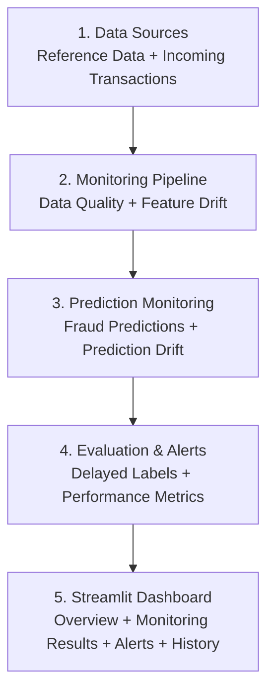

# DriftWatch
### Fraud Model Monitoring & Observability

**An end-to-end machine learning monitoring dashboard for detecting data quality issues, feature drift, prediction drift, and model performance degradation.**

DriftWatch is a Python-based monitoring application built with Streamlit to demonstrate how a trained fraud detection model can be monitored beyond its initial training and evaluation.

The project focuses on the post-training ML lifecycle: monitoring incoming transaction batches, identifying changes in data distributions, tracking prediction behaviour, evaluating delayed labels, and generating model health alerts.

---

## Project Overview

Machine learning models operate in changing environments. The characteristics of incoming data can differ from the data used during model training, potentially affecting prediction behaviour and model reliability.

DriftWatch addresses this monitoring challenge through an interactive dashboard that evaluates incoming transaction batches against a reference dataset and baseline model performance.

Rather than concentrating on model training, this project explores **ML monitoring, observability, statistical drift detection, and delayed feedback evaluation.**

## Architecture

DriftWatch follows a simple monitoring workflow that takes incoming transaction data, performs model monitoring, evaluates performance, and displays the results through an interactive dashboard.

### System Architecture



### Architecture Components

| Component | Description |
|---|---|
| **1. Data Sources** | Provides the reference dataset and incoming transaction batches for monitoring. |
| **2. Monitoring Pipeline** | Validates incoming data quality and compares feature distributions against reference data to identify drift. |
| **3. Prediction Monitoring** | Uses the trained Random Forest model to generate fraud predictions and monitors changes in prediction distributions. |
| **4. Evaluation & Alerts** | Evaluates model performance when actual labels become available, compares results with baseline metrics, and generates model health alerts. |
| **5. Streamlit Dashboard** | Displays overall model health, data drift, prediction monitoring, performance metrics, alerts, and monitoring history. |

### End-to-End Workflow

1. **Data Input:** Load reference data and upload a new transaction batch.
2. **Data Monitoring:** Perform data quality checks and detect changes in incoming feature distributions.
3. **Prediction Monitoring:** Generate fraud predictions and compare current prediction behaviour with reference predictions.
4. **Performance Evaluation:** When actual transaction labels become available, evaluate model performance using Precision, Recall, F1-score, and PR-AUC.
5. **Reporting & Visualization:** Generate monitoring reports, produce alerts, and display results through the Streamlit dashboard.

### Monitoring Lifecycle

DriftWatch supports two stages of monitoring:

- **Before actual labels are available:** Data quality, feature drift, prediction drift, and initial model health are monitored.
- **After actual labels become available:** Model performance is evaluated against the actual transaction outcomes and compared with baseline performance.

This workflow demonstrates how machine learning models can be monitored beyond their initial training and evaluation.
## Key Features

### 1. Data Quality Monitoring
- Validates incoming transaction data.
- Checks data quality before downstream monitoring.
- Supports validation of incoming feature schemas.

### 2. Feature Drift Detection
- Compares incoming feature distributions against reference data.
- Uses Population Stability Index (PSI).
- Uses the Kolmogorov–Smirnov (KS) statistical test.
- Identifies features exhibiting distribution changes.

### 3. Prediction Drift Monitoring
- Tracks changes in predicted fraud rates.
- Compares current and reference prediction probability distributions.
- Uses statistical testing to identify prediction drift.

### 4. Delayed-Label Performance Monitoring
- Supports actual labels arriving after predictions have been generated.
- Matches actual outcomes with saved predictions using transaction IDs.
- Evaluates Precision, Recall, F1-score, and PR-AUC.
- Compares current batch performance against baseline metrics.

### 5. Alert Engine
- Combines data quality, feature drift, prediction drift, and available performance signals.
- Generates monitoring alerts.
- Assigns an overall model health status: HEALTHY, WARNING, or CRITICAL.

### 6. Interactive Monitoring Dashboard
- Overview of model health.
- Incoming transaction batch uploads.
- Feature-level drift analysis.
- Prediction distribution monitoring.
- Delayed-label performance evaluation.
- Monitoring history and alerts.

## Technology Stack

| Category | Technologies |
|---|---|
| Programming Language | Python |
| Data Processing | Pandas, NumPy |
| Machine Learning | Scikit-learn |
| Statistical Analysis | SciPy |
| Dashboard | Streamlit |
| Visualization | Plotly, Matplotlib, Seaborn |
| Model Persistence | Joblib |
| Version Control | Git, GitHub |

## Model Information

DriftWatch uses a Random Forest classifier trained on a credit card fraud detection dataset.

**Model configuration**

- Algorithm: Random Forest Classifier
- Number of estimators: 100
- Random state: 42
- Class weighting: Balanced
- Parallel processing: Enabled

### Baseline Model Performance

The following metrics were obtained during the initial test evaluation.

| Evaluation Metric | Baseline Score |
|---|---:|
| Precision | 91.53% |
| Recall | 76.06% |
| F1-score | 83.08% |
| PR-AUC | 79.67% |
| ROC-AUC | 95.43% |

The original dataset contains a highly imbalanced target distribution, with approximately 0.17% fraudulent transactions.

These baseline metrics are used as a reference when evaluating subsequent transaction batches.

## Experimental Drift Scenarios

To validate the monitoring pipeline, controlled transaction batches were generated from the reference dataset.

| Batch Type | Configuration |
|---|---|
| Normal Batches | Sampled from reference data |
| Drifted Batch 1 | Amount multiplied by 2.5 |
| Drifted Batch 2 | Amount multiplied by 4 |

Each generated batch contains:

- 1,000 transactions
- 995 legitimate transactions
- 5 fraudulent transactions

The controlled fraud proportion of 0.5% is used for demonstration and differs from the original dataset prevalence.

### Key Experimental Observation

In the `drift_demo_1` experiment:

- DriftWatch detected distribution drift in the `Amount` feature.
- The prediction probability distribution test did not detect statistically significant prediction drift.
- The current predicted fraud rate was higher than the reference fraud rate.

This demonstrates an important monitoring concept:

**Feature drift does not necessarily imply prediction drift.**

A change in incoming feature distributions does not automatically mean that the model's prediction distribution or predictive performance has degraded.

## Delayed-Label Performance Evaluation

In practical fraud detection scenarios, actual transaction outcomes may not be available when predictions are generated.

DriftWatch simulates this situation by accepting a separate labels CSV after the initial monitoring process.

**Expected labels file format**

| transaction_id | actual_class |
|---|---:|
| transaction_001 | 0 |
| transaction_002 | 1 |
| transaction_003 | 0 |

The application matches actual outcomes with saved predictions using `transaction_id`.

It then calculates:

- Precision
- Recall
- F1-score
- PR-AUC

### Example: Drifted Batch 1 Performance

| Metric | Baseline | Current Batch |
|---|---:|---:|
| Precision | 91.53% | 100.00% |
| Recall | 76.06% | 80.00% |
| F1-score | 83.08% | 88.89% |
| PR-AUC | 79.67% | 100.00% |

**Interpretation:** The monitored batch showed improved metrics compared with the baseline in this experiment, despite the detected feature drift.

However, the batch contained only five fraudulent transactions. Therefore, these results are illustrative and should not be interpreted as evidence of general model improvement.

## Project Structure

```text
DriftWatch/
│
├── data/
│   ├── batches/
│   └── incoming_samples/
│
├── models/
│   └── fraud_model.pkl
│
├── reports/
│
├── src/
│   ├── inspect_data.py
│   ├── prepare_data.py
│   ├── train_model.py
│   ├── save_baseline.py
│   ├── generate_batches.py
│   ├── data_quality.py
│   ├── test_data_quality.py
│   ├── drift_detection.py
│   ├── test_drift_detection.py
│   ├── prediction_drift.py
│   ├── test_prediction_drift.py
│   ├── performance_monitor.py
│   ├── generate_delayed_labels.py
│   ├── test_performance_monitor.py
│   ├── alert_engine.py
│   ├── monitoring_pipeline.py
│   ├── test_pipeline.py
│   └── run_monitor.py
│
├── app.py
├── requirements.txt
├── README.md
└── PROJECT_DOCUMENTATION.md
```

*Note: Dataset files, generated reports, and other runtime artifacts may be stored locally and are not necessarily included in the GitHub repository.*

## Installation and Setup

### Prerequisites

- Python 3.10 or later
- Git
- pip

### 1. Clone the Repository

```bash
git clone https://github.com/Joyslin-2006/DriftWatch.git
cd DriftWatch
```

### 2. Create a Virtual Environment

```bash
python -m venv .venv
```

Activate the environment on Windows PowerShell:

```powershell
.venv\Scripts\Activate.ps1
```

### 3. Install Dependencies

```bash
pip install -r requirements.txt
```

### 4. Prepare Project Artifacts

Ensure the required dataset, reference data, trained model, and baseline metrics are available in their expected directories.

If starting from the original dataset, execute the preparation, training, baseline generation, and batch-generation scripts in the appropriate order.

### 5. Launch DriftWatch

```bash
streamlit run app.py
```

The application will open in your browser.

## How to Use DriftWatch

1. Launch the Streamlit application.
2. Navigate to **Incoming Data**.
3. Upload a transaction batch containing the required transaction ID and model features.
4. Enter a batch name and run monitoring.
5. Review overall health and monitoring results in **Overview**.
6. Inspect feature-level changes in **Data Monitoring**.
7. Examine prediction distributions in **Prediction Monitoring**.
8. Upload the corresponding actual labels when they become available.
9. Evaluate model performance in **Model Performance**.
10. Review saved results in **Monitoring History** and **Alerts**.

## Limitations

- This is an experimental portfolio project and not a production deployment.
- Controlled batches are used to demonstrate monitoring behaviour.
- Each generated evaluation batch contains only five fraud examples, so batch-level performance metrics can be unstable.
- Feature drift does not automatically indicate model performance degradation.
- Statistical drift tests should be interpreted alongside sample sizes and business context.
- The project does not currently implement automated model retraining, production model serving, or a live banking transaction integration.

## Future Enhancements

- Configurable drift detection thresholds.
- Scheduled and automated monitoring.
- Model version tracking.
- More realistic evaluation datasets and larger batch sizes.
- Enhanced alert history and notification integration.
- Cloud deployment and monitoring.
- Automated model retraining workflows.

## Author

**Joyslin**

Developed as a hands-on machine learning engineering project exploring ML observability, statistical drift detection, delayed feedback, and model performance monitoring.

---

**Project:** DriftWatch — Fraud Model Monitoring & Observability

**Repository:** [GitHub – DriftWatch](https://github.com/Joyslin-2006/DriftWatch)
